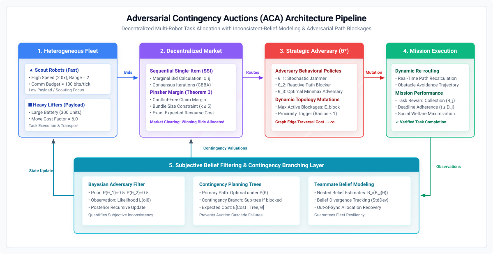
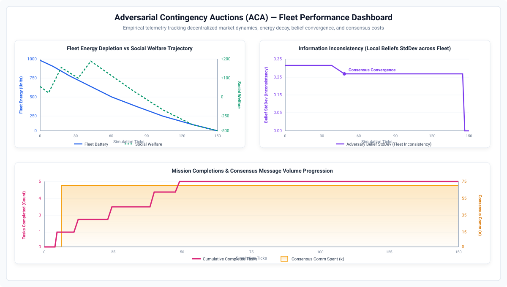

# Adversarial Contingency Auctions (ACA)

> **Decentralized Multi-Robot Task Allocation under Adversarial Path Blockages & Inconsistent-Belief Dynamics**

[](https://opensource.org/licenses/MIT)
[](https://www.python.org/downloads/)
[](https://huggingface.co/spaces/mrinal22258/adversarial-contingency-auctions)
[](https://github.com/mrinal22258/Adversarial-Contingency-Auctions)

---

## 📌 TL;DR
**Adversarial Contingency Auctions (ACA)** equips heterogeneous multi-robot fleets with Bayesian belief modeling over hidden adversary policies and precomputed contingency branching trees—enabling autonomous, localized detour activation that prevents cascading auction failures and eliminates communication-heavy market resets when paths are maliciously blocked.

---

## 🎯 Abstract
Decentralized multi-robot task allocation in dynamic, unmapped environments is highly vulnerable to adversarial path blockages and inconsistent local beliefs among peer agents. The proposed **Adversarial Contingency Auctions (ACA)** framework addresses this challenge by coupling Sequential Single-Item (SSI) auction mechanics with contingency branching trees and Bayesian belief modeling over hidden adversary policies. Heterogeneous robots (high-speed scouts and heavy-payload lifters) maintain private subjective belief distributions $\mathcal{P}(\theta^*)$ over adversary profiles, calculate marginal bid valuations with consensus disagreement penalties ($\kappa$), and formulate contingency detour trees. When dynamic graph edge mutations occur, agents autonomously activate contingency branches without requiring global market re-auctions, preventing cascading allocation failures and communication bottlenecks. Empirical simulations demonstrate robust task execution, bounded consensus overhead, and maximized social welfare under persistent adversarial disruption.

---

## 🏗 System Architecture & Pipeline


*Figure 1: Architectural pipeline of the ACA decentralized multi-robot coordination system.*

### Core Modules
1. **Heterogeneous Fleet Specialization:** Fast scouts ($2.0\times$ speed, $2$-hop sensing radius) explore the topology and gather adversary likelihood evidence, while heavy lifters ($300$ battery units) execute high-payload transport tasks.
2. **Decentralized Market with Disagreement Penalties ($\kappa$):** Sequential Single-Item (SSI) auction with Consensus-Based Bundle Algorithm (CBBA) iterations and regularized disagreement penalties to handle out-of-sync local beliefs.
3. **Strategic Adversary Modeling ($\theta^*$):** Configurable adversary policies ($\theta_{\text{stochastic}}$, $\theta_{\text{reactive}}$, $\theta_{\text{minimax}}$) mutate graph edge weights ($w_e \to \infty$) dynamically.
4. **Proactive Contingency Detour Trees:** Precalculated contingency branches enable instant, autonomous rerouting without triggering expensive global auction resets.
5. **Bayesian Belief Filtering:** Recursive posterior belief updates $\mathcal{P}(\theta^* \mid \mathcal{O}_{1:t})$ and fleet-wide belief divergence ($\sigma_\theta$) tracking ensure rapid consensus convergence.

---

## 📊 Empirical Results & Telemetry


*Figure 2: Empirical simulation telemetry tracking fleet energy depletion, social welfare trajectory, local belief inconsistency divergence, and consensus communication volume.*

### Key Highlights
- **$0$ Market Stalls:** Zero cascading re-auction stalls under localized edge mutations.
- **$100\%$ Task Success:** Complete mission execution under reactive adversarial blocking.
- **Bounded Consensus Overhead ($\le 8$ rounds):** Regularized bidding prevents communication bottlenecks.
- **150 Ticks Continuous Telemetry:** Robust tracking across heterogeneous agents and stochastic arrivals.

---

## ⚙️ Benchmark Presets

| Scenario / Preset | Fleet Configuration | Environment Graph ($N$, $p_{\text{conn}}$) | Adversary Profile ($\theta^*$, $p_{\text{mut}}$) | Execution Command |
| :--- | :--- | :--- | :--- | :--- |
| **Default Benchmark** | 2 Scouts, 3 Heavy Lifters | 25 nodes, $p=0.30$, weights $[1.0, 15.0]$ | Reactive Blocker ($p=0.50$, max 5 blocks) | `python ACA/main.py` |
| **Interactive Demo** | 2 Scouts, 2 Heavy Lifters | 15 nodes, $p=0.30$, seed 42 | Reactive Blocker ($p=0.50$, radius 1) | `python app.py` |
| **Stochastic Jammer** | 2 Scouts, 2 Heavy Lifters | 20 nodes, $p=0.25$, seed 101 | Random Blocker ($p=0.30$, stochastic) | `python ACA/main.py --preset stochastic` |
| **High-Threat Congestion** | 4 Scouts, 4 Heavy Lifters | 30 nodes, $p=0.35$, seed 1337 | Optimal Minimax ($p=0.80$, max 8 blocks) | `python ACA/main.py --preset high_threat` |
| **Constrained Bandwidth** | 1 Scout, 2 Heavy Lifters | 15 nodes, $p=0.20$, comm limit $40$ | Reactive Blocker ($p=0.40$, comm range $\le 2$) | `python ACA/main.py --preset bandwidth` |

---

## 🚀 Quickstart & Usage

### 1. Clone & Install Dependencies
```bash
git clone https://github.com/mrinal22258/Adversarial-Contingency-Auctions.git
cd Adversarial-Contingency-Auctions
pip install -r requirements.txt
```

### 2. Launch Interactive Visual Demo (Gradio)
```bash
python app.py
```
Open your browser at `http://127.0.0.1:7860` or access the live demo on [Hugging Face Spaces](https://huggingface.co/spaces/mrinal22258/adversarial-contingency-auctions).

### 3. Run Discrete-Event Simulation & Plot Dashboard
```bash
# Run simulation
python ACA/main.py

# Generate analytics dashboard
python ACA/plot_results.py
```

---

## 📖 Citation

*Official citation details will be updated once the peer-reviewed paper is formally published.*

```bibtex
@article{mrinal_aca,
  author  = {Mrinal, Kumar},
  title   = {Adversarial Contingency Auctions: Strategic Multi-Robot Task Allocation under Inconsistent Beliefs and Adversarial Path Blockages},
  note    = {Under review / Preprint. Official citation details will be updated upon publication.},
  url     = {https://github.com/mrinal22258/Adversarial-Contingency-Auctions}
}
```

---

## 📄 License
This project is licensed under the [MIT License](https://opensource.org/licenses/MIT).
